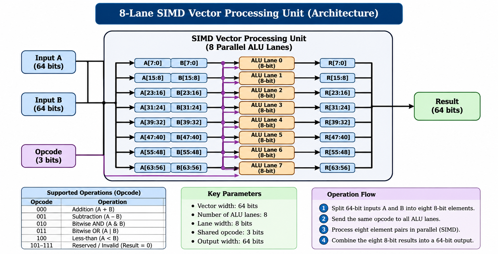

# 8-Lane SIMD Vector Processing Unit

Design, implementation, and verification of an 8-lane SIMD (Single Instruction, Multiple Data) Vector Processing Unit using Verilog HDL.

This project demonstrates parallel data processing using eight independent 8-bit ALU lanes controlled by a shared 3-bit opcode.

---

## 1. Project Overview

The 8-Lane SIMD Vector Processing Unit processes 64-bit input vectors using eight parallel ALU lanes.

Each lane processes one 8-bit element from input vectors A and B. All lanes execute the same operation simultaneously.

### Key Features

- 8 parallel ALU lanes.
- 8-bit unsigned data processing per lane.
- 64-bit input and output vectors.
- Shared 3-bit opcode.
- Five supported ALU operations.
- Combinational SIMD datapath.
- Scalar vs SIMD performance comparison.
- Self-checking Verilog testbenches.

---

## 2. Architecture Overview

| Parameter | Specification |
|---|---|
| Number of ALU lanes | 8 |
| Data width per lane | 8 bits |
| Input vector width | 64 bits |
| Output vector width | 64 bits |
| Opcode width | 3 bits |
| Execution model | Combinational |
| Processing type | Parallel |

### Architecture Diagram

The following diagram illustrates the overall SIMD architecture, including input splitting, shared opcode distribution, parallel ALU processing, and output combination.



### How It Works

1. Two 64-bit input vectors (A and B) are provided.
2. Each vector is divided into eight 8-bit elements.
3. The same 3-bit opcode is sent to all eight ALU lanes.
4. Each ALU processes its corresponding pair of elements simultaneously.
5. The eight 8-bit results are combined into one 64-bit output vector.

---

## 3. Supported ALU Operations

The ALU supports five operations.

| Opcode | Operation | Expression |
|:---:|---|---|
| `000` | Addition (ADD) | `result = A + B` |
| `001` | Subtraction (SUB) | `result = A - B` |
| `010` | Bitwise AND | `result = A & B` |
| `011` | Bitwise OR | `result = A \| B` |
| `100` | Less-than comparison (LT) | `result = (A < B) ? 8'd1 : 8'd0` |

Arithmetic operations use 8-bit results, so overflow and underflow follow modulo-256 behavior.

Reserved opcodes (`101`, `110`, and `111`) produce a default result of zero.

---

## 4. Project Directory Structure

```text
SIMD-Vector-Processing-Unit/
│
├── rtl/
│   ├── alu.v
│   ├── simd_top.v
│   ├── control_unit.v
│   ├── opcode_defs.vh
│   └── vector_register.v
│
├── testbench/
│   ├── alu_tb.v
│   ├── simd_tb.v
│   ├── simd_verification_tb.v
│   ├── control_tb.v
│   ├── register_tb.v
│   ├── scalar_tb.v
│   └── scalar_performance_tb.v
│
├── results/
│   ├── performance_comparison.md
│   ├── simulation_results.md
│   ├── test_cases.md
│   ├── control_unit.md
│   ├── vector_register.md
│   ├── simd_verification_sim.log
│   ├── control_sim.log
│   └── register_sim.log
│
├── evidence/
│   ├── simd_verification.log
│   ├── simd_basic.log
│   ├── scalar_verification.log
│   └── scalar_performance.log
│
├── docs/
│   └── architecture.png
│
├── README.md
└── .gitignore
```

---

## 5. Technologies Used

- **Verilog HDL:** Hardware description and design.
- **Icarus Verilog:** Compilation and simulation.
- **VVP:** Simulation execution.
- **GTKWave:** Optional waveform visualization.
- **Git and GitHub:** Version control and project documentation.

---

## 6. Simulation and Verification

### Prerequisites

Install the following tools:

- [Icarus Verilog](http://iverilog.icarus.com/)
- [GTKWave](https://gtkwave.sourceforge.net/) (optional)

### 6.1 Run Comprehensive SIMD Verification

Compile:

```bash
iverilog -g2012 -I rtl -s simd_verification_tb -o simd_test rtl/alu.v rtl/simd_top.v rtl/control_unit.v rtl/vector_register.v testbench/simd_verification_tb.v
```

Execute:

```bash
vvp simd_test
```

**Verification Result:**

- Total checks: 184
- Passed: 184
- Failed: 0

### 6.2 Run Basic SIMD Testbench

Compile:

```bash
iverilog -g2012 -I rtl -s simd_tb -o simd_basic rtl/alu.v rtl/simd_top.v testbench/simd_tb.v
```

Execute:

```bash
vvp simd_basic
```

### 6.3 Run Scalar vs SIMD Verification

This testbench processes the eight elements sequentially using a scalar ALU model and compares the output with the existing SIMD design.

Compile:

```bash
iverilog -g2012 -I rtl -s scalar_tb -o scalar_test rtl/alu.v rtl/simd_top.v testbench/scalar_tb.v
```

Execute:

```bash
vvp scalar_test
```

**Verification Result:**

- Total tests: 6
- Passed: 6
- Failed: 0

### 6.4 Run Scalar Performance Model

The clocked scalar performance model processes one 8-bit element per rising clock edge.

Compile:

```bash
iverilog -g2012 -I rtl -s scalar_performance_tb -o scalar_perf rtl/alu.v rtl/simd_top.v testbench/scalar_performance_tb.v
```

Execute:

```bash
vvp scalar_perf
```

**Observed Result:**

- Scalar ALUs: 1
- Scalar model cycles: 8
- Elements processed sequentially: 8
- Scalar and SIMD outputs: Identical
- Verification: PASSED

---

## 7. Scalar vs SIMD Performance Analysis

The project compares a sequential scalar processing model with the existing 8-lane SIMD architecture.

| Parameter | Scalar Model | SIMD Design |
|---|---:|---:|
| Number of ALUs | 1 | 8 |
| ALU width | 8 bits | 8 bits per lane |
| Elements processed per step | 1 | 8 |
| Processing style | Sequential | Parallel |
| Steps for 8 elements | 8 clock cycles | One combinational evaluation |
| Parallelism | 1-way | 8-way |

### Performance Highlights

**Scalar Processing**
- Uses one ALU.
- Processes one element at a time.
- Requires eight modelled clock cycles for eight elements.

**SIMD Processing**
- Uses eight ALU lanes.
- Processes eight elements simultaneously.
- Uses one shared opcode across all lanes.

### Theoretical Parallelism

The ratio of SIMD lanes to scalar ALUs is:

```text
8 / 1 = 8
```

Therefore, the architecture provides 8-way data parallelism.

**Important:** The current SIMD datapath is combinational and has no clock input. The scalar clock cycles come from an illustrative clocked testbench. Therefore, this comparison does not establish a measured 8x hardware speed-up. Actual hardware speed-up requires comparable clocked implementations and timing measurements.

For detailed analysis, see [Performance Comparison](results/performance_comparison.md).

---

## 8. Verification Results

### Existing SIMD Verification

The comprehensive verification suite covers 184 automated lane checks across seven test categories:

1. **Vector Addition:** Verified addition across all eight lanes.
2. **Vector Subtraction:** Verified positive differences, zero equality, and underflow wraparound.
3. **Bitwise AND:** Tested complementary and masking bit patterns.
4. **Bitwise OR:** Tested complementary and identity properties.
5. **Comparison:** Tested less-than, equal, greater-than, and mixed conditions.
6. **Boundary and Edge Testing:** Verified zeros, 255, overflow, and boundary conditions.
7. **Rapid Dynamic Opcode Switching:** Tested combinational updates during rapid opcode changes.

**Final Result: 184 checks passed with zero errors.**

### Scalar vs SIMD Verification

The scalar model was tested against the SIMD design for all five supported operations and one invalid opcode.

| Metric | Result |
|---|---:|
| Total tests | 6 |
| Passed | 6 |
| Failed | 0 |
| Status | PASS |

Both models generated identical 64-bit output vectors.

---

## 9. Evidence and Documentation

The project includes simulation logs and technical documentation.

| File | Description |
|---|---|
| `evidence/simd_verification.log` | Comprehensive SIMD verification output |
| `evidence/simd_basic.log` | Basic SIMD simulation output |
| `evidence/scalar_verification.log` | Scalar vs SIMD verification output |
| `evidence/scalar_performance.log` | Clocked scalar performance model output |
| `results/performance_comparison.md` | Detailed performance comparison |
| `results/simulation_results.md` | Comprehensive verification report |
| `results/test_cases.md` | Test case specifications |
| `docs/architecture.png` | SIMD architecture diagram |

Waveforms can also be inspected using GTKWave.

Example:

```bash
gtkwave simd_verification.vcd
```

---

## 10. Advantages of SIMD Architecture

1. **Parallel Processing:** Eight data elements are processed simultaneously.
2. **Higher Data Throughput Potential:** Multiple ALU lanes increase parallel processing capacity.
3. **Shared Control:** All ALU lanes use the same opcode.
4. **Efficient Vector Operations:** Suitable for repeated operations on multiple data elements.

---

## 11. Limitations

1. The current SIMD datapath is combinational and does not include a clocked pipeline.
2. All lanes execute the same instruction.
3. The design supports fixed 8-bit elements.
4. Eight ALU lanes require more hardware resources than a single scalar ALU.
5. Hardware frequency, power consumption, area, and actual speed-up have not been measured.

---

## 12. Conclusion

The 8-Lane SIMD Vector Processing Unit demonstrates the use of parallel processing in digital hardware.

The scalar model processes one element at a time, while the SIMD architecture processes eight elements simultaneously using eight parallel ALU lanes.

Both models successfully produced identical outputs during verification.

The project demonstrates 8-way data parallelism and highlights the potential advantages of SIMD architecture for vector-based computations.

---

**Project:** 8-Lane SIMD Vector Processing Unit
**Language:** Verilog HDL
**Simulation Tool:** Icarus Verilog
**Architecture:** 8-Lane SIMD
