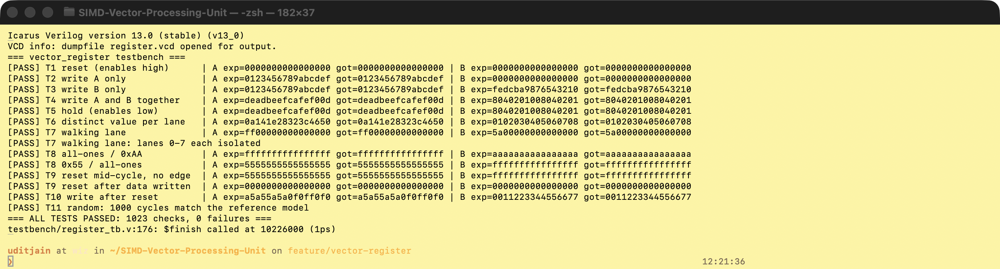
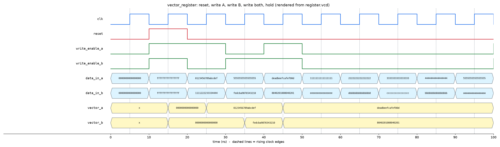

# Vector Register File: verification results

Issue #2. Design: `rtl/vector_register.v`. Testbench: `testbench/register_tb.v`.

## How to reproduce

```
iverilog -g2012 -o register_sim rtl/vector_register.v testbench/register_tb.v
vvp register_sim
```

Tool: Icarus Verilog 13.0 (stable). Raw output: [`register_sim.log`](register_sim.log).
The run also writes `register.vcd` (git-ignored) for GTKWave or Surfer.

## Register architecture

| Signal | Dir | Width | Meaning |
|---|---|---|---|
| `clk` | in | 1 | registers update on the rising edge |
| `reset` | in | 1 | active-high, **synchronous**; clears both vectors; has priority over the write enables |
| `write_enable_a` | in | 1 | load `data_in_a` into `vector_a` on the next edge |
| `write_enable_b` | in | 1 | load `data_in_b` into `vector_b` on the next edge |
| `data_in_a`, `data_in_b` | in | 64 | new vector data |
| `vector_a`, `vector_b` | out | 64 | registered vectors that feed `simd_top.A` / `simd_top.B` |

Lane layout matches `simd_top`: lane *i* = `vector[i*8 +: 8]` (lane 0 = bits 7:0, lane 7 = bits 63:56).
When an enable is low, that register keeps its value. Both registers can be written in the same cycle.

## Test cases (all passed)

Every check compares all 8 lanes of both vectors and stops with `$fatal` naming the lane on the first mismatch.

| # | What it tests | Expected A | Expected B | Result |
|---|---|---|---|---|
| T1 | reset with both enables high and data all-ones (reset wins) | `0000000000000000` | `0000000000000000` | PASS |
| T2 | write A only; data on `data_in_b` must be ignored | `0123456789abcdef` | `0000000000000000` | PASS |
| T3 | write B only; A holds although `data_in_a` changed | `0123456789abcdef` | `fedcba9876543210` | PASS |
| T4 | write A and B in the same cycle, different values | `deadbeefcafef00d` | `8040201008040201` | PASS |
| T5 | enables low for 5 cycles while inputs change every cycle | `deadbeefcafef00d` | `8040201008040201` | PASS |
| T6 | a different value in each lane (same vectors as `simd_tb`) | `0a141e28323c4650` | `0102030405060708` | PASS |
| T7 | walking lane: only lane k set, k = 0..7 (catches swapped/merged/stuck lanes) | `ff << 8k` | `5a << 8k` | PASS (8/8) |
| T8 | boundary patterns | `ffff…` / `5555…` | `aaaa…` / `ffff…` | PASS |
| T9 | reset raised between edges changes nothing until the next edge; then clears written data | held, then `0` | held, then `0` | PASS |
| T10 | writes work again after reset is released | `a5a55a5a0f0ff0f0` | `0011223344556677` | PASS |
| T11 | 1000 random cycles (random data, random enables, reset ~1 in 16) vs a reference model | model | model | PASS |

Total: **1023 checks, 0 failures**.

## Does the testbench catch real bugs?

A passing testbench only means something if it fails on broken hardware. I ran it against six deliberately broken copies of the RTL; it stopped every one:

| Injected bug | First failing check |
|---|---|
| `write_enable_a` ignored (A always loads) | T3: vector_a lane 0 expected `ef` got `55` |
| reset made asynchronous | T9: vector_a cleared before the clock edge |
| write enables beat reset | T1: vector_a lane 0 expected `00` got `ff` |
| lanes 0 and 1 of B swapped | T3: vector_b lane 0 expected `10` got `32` |
| B loaded from `data_in_a` | T3: vector_b lane 0 expected `10` got `55` |
| one bit of lane 3 stuck at 0 | T2: vector_a lane 3 expected `89` got `09` |

## Evidence

Terminal run (screenshot of the actual simulation):



Waveform, first 100 ns (T1 to T5), drawn from the `register.vcd` this testbench produces:



Reading it: reset at 15 ns clears both vectors although both enables are high. At 25 ns only A loads. At 35 ns only B loads. At 45 ns both load together. From 55 ns the enables are low, the inputs change every cycle, and the outputs hold.

## Known limitations

- Fixed at 2 registers × 64 bits, as the issue specifies. Not yet connected to `simd_top`; wiring the registers to the datapath is left to the control unit (#3) / integration.
- Verified in simulation only (Icarus). Not synthesised for an FPGA yet.
